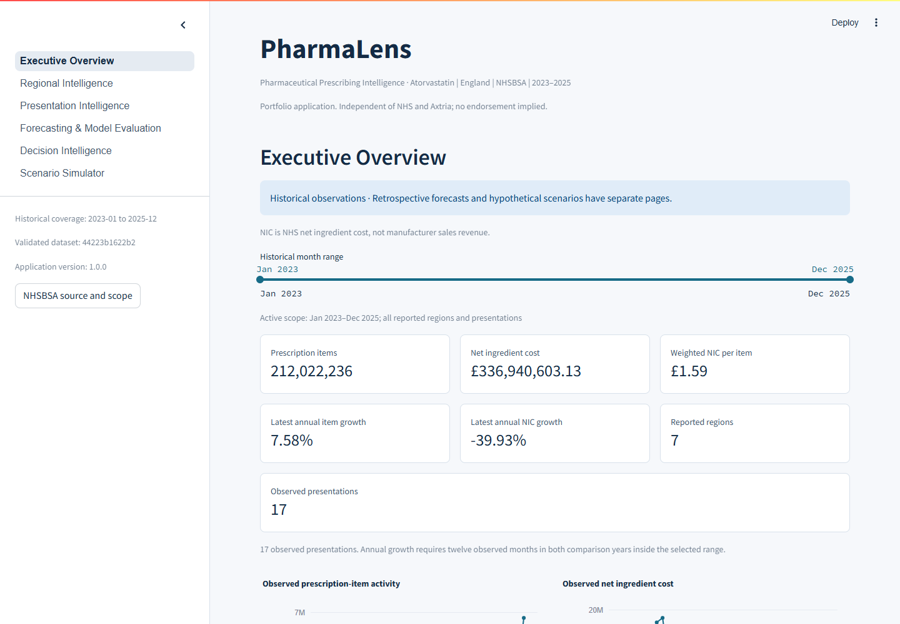

# PharmaLens — Pharmaceutical Prescribing Intelligence

**Release status:** Prepared for release — awaiting authorization. GitHub and Streamlit Cloud links will appear only after publication and verification.

To run locally: `python -m pip install -r requirements.txt` then `streamlit run app.py`. Cloud deployment uses `app.py` on the `main` branch. For the full analytical pipeline, use `requirements-analytics.txt`.

## Executive summary

An independent, AI-assisted analytics portfolio that turns public NHSBSA atorvastatin records into traceable prescribing insights, retrospective forecast evaluation and an interactive dashboard. Prepared for an Axtria Analyst interview discussion; no NHSBSA or Axtria endorsement, client work or deployment is implied.

## Problem statement

How do recorded prescription items and ingredient cost change across months, regions and presentations? How reliable are simple forecasts, and which analytical uncertainties deserve review? The project separates observed findings, model evidence, policy assumptions and hypothetical accounting.

## Dataset and scope

| Scope | Verified value |
|---|---|
| Publisher / medicine / geography | NHSBSA monthly PCA / atorvastatin / England community dispensing |
| Historical window | January 2023–December 2025; 36 months |
| Source / analytical records | 50,456 / 3,920 |
| Reported regions / presentations | 7 / 17 |
| Fact grain | Month × region × BNF presentation, retaining unit |

## Key verified findings

- Historical activity: **212,022,236 prescription items** and **£336,940,603.13 NIC**.
- 2025 versus 2024: items **+7.58%**, NIC **-39.93%**.
- NIC accounting change: volume **£7,478,389.50**, presentation mix **£1,254,765.30**, within-presentation NIC/item **£-59,243,626.55**; total **£-50,510,471.75**. This identity is not a causal explanation.
- National ETS holdout MASE **0.8883**, WAPE **3.684%**. Ridge's lower final observed error does not replace the development-frozen ETS choice.
- **13 presentations remain unscored**; all **7 regional ranks** are policy-sensitive. Proposed investigations are not observed business actions.

## Dashboard preview



These are actual local browser captures, not generated mockups. [All six screenshots](docs/PHASE7_SIX_MINUTE_DEMO.md) accompany the demo; desktop, laptop, tablet and mobile checks are recorded in the final audit. Screenshot views are historical defaults, not current forecasts.

## Features

Interactive scope filters, weighted KPIs, source/formula explanations, origin-labelled forecast markers, scored/unscored monitoring views, validated policy sensitivity, searchable investigation evidence, bounded accounting scenarios and filtered CSV downloads. The runtime reads registered hash-checked Parquet datasets without retraining models.

## Architecture


[Detailed architecture and KPI lineage](docs/PROJECT_ARCHITECTURE.md).

## Data pipeline

Immutable API responses and receipts → quality checks → normalized monthly data → analytical SQL → diagnostics → frozen forecasts → decision marts → dashboard. Unknown missing activity stays unknown; physical quantities across incompatible units are not summed.

## SQL analytics

DuckDB uses explicit fact/dimension grains, a calendar, controlled join cardinality and reporting views. Month-on-month changes use adjacent calendar months. Shares disclose their denominator; weighted cost uses ratio of sums. [Metric definitions](docs/METRIC_DEFINITIONS.md).

## Statistical analysis

Calendar-aware OLS with conditional HAC uncertainty, Theil–Sen and descriptive Kendall assess trend robustness. STL, ACF and day-adjusted indices are exploratory with only three cycles. Retained IQR/MAD/change flags are investigation signals. The NIC decomposition is an exact symmetric accounting identity. [Methodology review](docs/PHASE7_FORECASTING_DEFENSE.md).

## Forecasting methodology

Expanding origins, initial 24-month history, 1–3 month horizons, training-only features/scalers, development alpha/family selection and frozen choices precede final holdout evaluation. Evaluation is retrospective fixed-vintage, not a reconstruction of record publication availability. Failed forecasts remain missing. No defensible intervals are supplied.

## Model comparison

| National family | Final holdout MASE | Role |
|---|---:|---|
| damped_ets | 0.8883 | Frozen operational choice |
| drift | 1.1183 | Evaluation benchmark; not selected by holdout |
| naive | 1.1070 | Evaluation benchmark; not selected by holdout |
| ridge | 0.8717 | Evaluation benchmark; not selected by holdout |
| seasonal_naive | 1.6404 | Evaluation benchmark; not selected by holdout |

Common successful origin/horizon support; overlapping errors limit inference. [Forecasting defense](docs/PHASE7_FORECASTING_DEFENSE.md).

## Decision intelligence

Five normalized review dimensions use configured weights and retain missing evidence. Monitoring scores are policy, not commercial opportunity. 15 of 36 selected series require manual review; 225 entries are proposed analyst investigations with source traceability.

## Scenario simulator

Hypothetical NIC = baseline items × (1 + volume change) × baseline NIC/item × (1 + unit-cost change). Separate mix transfer preserves total items and nonnegative shares. +5% items and −5% NIC/item imply £75,783,764.03 hypothetical NIC on the observed 2025 baseline. These are not probabilities, causal interventions, savings or clinical substitution advice.

## Dashboard pages

| Page | Purpose |
|---|---|
| Executive Overview | Active-window totals, trends and full-year accounting |
| Regional Intelligence | Scoped comparisons, shares, growth and profile caveats |
| Presentation Intelligence | Concentration, unit-aware presentation evidence and coverage |
| Forecasting & Model Evaluation | Frozen choices, origins/horizons, errors and hierarchy gaps |
| Decision Intelligence | Components, sensitivity, unscored status and proposed investigations |
| Scenario Simulator | Explicit hypothetical volume, cost and mix assumptions |

## Tech stack

Python 3.12, pandas, NumPy, DuckDB, SciPy/statsmodels, scikit-learn, Parquet/PyArrow, Plotly, Streamlit, pytest/AppTest. Phase 7 adds Ruff, Playwright with installed Chrome, and python-pptx for QA/portfolio deliverables.

## Installation

```powershell
python -m venv .venv
.venv\Scripts\python.exe -m pip install -r requirements-dashboard.txt
```

Dashboard data must come from the matching validated package; a code-only clone lacks ignored reporting files. Use `requirements.txt` for the full analytical/test environment and `requirements-portfolio.txt` for Phase 7 tooling.

## Running the pipeline

Phase commands are `python run_pipeline.py --phase 1` through `--phase 5`. They are for an isolated historical reproduction with matching source snapshots. Phase 7 verifies existing results without retraining/reselecting or replacing validated data. [Exact reproducibility instructions](docs/REPRODUCIBILITY_GUIDE.md).

## Running the dashboard

```powershell
.venv\Scripts\python.exe -m streamlit run app.py --server.address 127.0.0.1 --server.port 8501 --server.headless true
```

Open `http://127.0.0.1:8501`; use `.venv/bin/python` on Linux/macOS. No cloud deployment is claimed.

## Tests

```powershell
.venv\Scripts\python.exe -m pytest tests/ci -q --confcutdir=tests/ci
.venv\Scripts\python.exe -m pytest -q
.venv\Scripts\python.exe -m src.phase7_audit
```

The first command uses deterministic data-free fixtures. Full regression needs original validated artifacts. Phase 7 independently reconciles 1,571 calculations; see the [final audit](docs/PHASE7_AUDIT.md) for executed tests, clean setup, browser evidence and protection counts. GitHub Actions is configured; no remote workflow run is claimed.

## Reproducibility

Pinned direct dependencies, recorded transitive environment, source/data hashes, exact contracts and immutable outputs support local reproduction. A separate fresh runtime checkout/venv is exercised. Full original-pipeline rebuilding in that environment is not claimed. [Guide](docs/REPRODUCIBILITY_GUIDE.md).

## Limitations

No manufacturer revenue, unique patients, population/case-mix rates, India transfer, causal NIC mechanism, realized savings or clinical recommendations. Missing activity has unknown mechanisms. Publication lag/revisions are not replayed. Short overlapping holdout, insufficient interval calibration and illustrative review weights limit operational use. Browser checks are scoped, not full accessibility certification or capacity testing.

## Data source and licence

[NHSBSA monthly PCA](https://opendata.nhsbsa.net/dataset/prescription-cost-analysis-pca-monthly-data), accessed 12 October 2026. Contains public sector information licensed under [OGL v3.0](https://www.nationalarchives.gov.uk/doc/open-government-licence/version/3/). [Attribution, exclusions and code-licence status](docs/DATA_SOURCES_AND_LICENSES.md). Source-code licence selection and publication authorization remain owner decisions.

## Future improvements

Fresh release-aware observations, prospective locked evaluation, user-reviewed policies, calibrated uncertainty when supported, hierarchical reconciliation trials, browser/accessibility expansion and a controlled Python-host deployment.

## Portfolio and interview materials

[Rendered PDF](deliverables/Phase7_Axtria_Project_Presentation.pdf). The separate local bundle is `deliverables/PharmaLens_Phase7_Portfolio.zip`; it is not nested inside itself. The deck was rendered by installed Microsoft PowerPoint and all twelve slides were visually inspected by the assistant.

[Presentation](deliverables/Phase7_Axtria_Project_Presentation.pptx) · [Six-minute demo](docs/PHASE7_SIX_MINUTE_DEMO.md) · [Question bank](docs/PHASE7_INTERVIEW_QA.md) · [Defense notes](docs/PHASE7_PROJECT_DEFENSE.md) · [Resume wording](docs/PHASE7_RESUME_BULLETS.md) · [Quality scorecard](docs/PHASE7_QUALITY_SCORECARD.md) · [Release checklist](docs/PHASE7_RELEASE_CHECKLIST.md).

AI assistance: Codex generated and executed substantial implementation/audit work. Project results are supported by reproducible evidence; personal contribution claims should reflect what the owner actually reviewed and understands. GitHub publication, remote Actions and cloud deployment were not performed.
