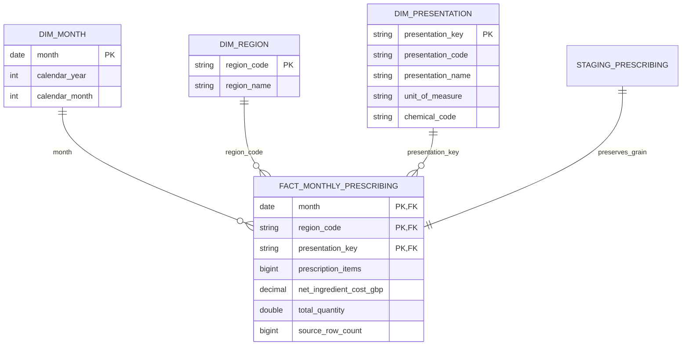

# Phase 2 data model and lineage

Use the existing **data/processed/pharma.duckdb** database. The Phase 1 `main.monthly_prescribing`
table is preserved and checked against its validated Parquet. The `phase2` schema contains a separate
analytical model with consistent definitions, not a competing database.

The Phase 1 baseline had 19 passing tests; the JUnit evidence is in
outputs/validation/phase2_baseline_tests.xml. config/settings.yaml was not present. Existing
config/dataset.json is retained; config/phase2.json adds only analytical thresholds and tolerances.

## Grain, relationships and refresh

Primary grain: **month × dispensing region × BNF presentation × unit of measure**. Presentation key
is presentation_code + `|` + unit. No supplier, SNOMED or preparation detail is invented from the
already aggregated Phase 1 monthly table. Those details remain in protected source_rows.parquet.

- staging_prescribing is a typed copy of the validated monthly Parquet, retaining provenance labels.
- dim_month is a complete configured monthly calendar, including periods absent from a test fixture.
- dim_region holds one label per observed region code; mapping ambiguity blocks loading.
- dim_presentation holds each valid presentation/unit pair and chemical classification.
- fact_monthly_prescribing preserves all 3,920 observed rows without inserting missing observations.
- parameters and threshold_parameters persist configuration used by reporting views.

Dimension and fact primary keys are enforced. Foreign-key relationships are logical and audited by
LEFT JOIN orphan checks rather than physical FK constraints, allowing transactional CREATE OR REPLACE
refreshes in DuckDB 1.1.3. INNER JOIN enrichment must have the same row count as the fact table.
The whole SQL build commits or rolls back in one transaction. CSV/Parquet exports use temporary files
and atomic replacement per file. A failed multi-file export is not globally atomic and does not constitute
a completed run; the successful-run manifest is written after the complete export batch.

## Source-to-target mapping

| Protected monthly Parquet | Analytical target | Transformation |
|---|---|---|
| month | month | Month-start DATE, original date validity checked |
| product_code/product_name | presentation_code/presentation_name | String identifiers preserved |
| unit_of_measure | dim_presentation.unit_of_measure | Included in key; incompatible units never crossed |
| region_code/region_name | dim_region | Exact source mapping |
| items | prescription_items | Validated integral counts → BIGINT |
| nic_gbp | net_ingredient_cost_gbp | Validated GBP cent representation → DECIMAL(20,2), no display rounding in reconciliation |
| total_quantity | total_quantity | Physical quantity retained as DOUBLE |
| chemical_code/chemical_name | dim_presentation | Exact source mapping |
| source_row_count | fact.source_row_count | Number of detailed contributors retained |
| data_origin | staging.data_origin | Must be observed_nhsbsa for production Phase 2 |

Items and NIC are additive across presentations/regions. Quantity is aggregated only within one
presentation/unit. Cost ratios divide aggregate totals. No national mixed-unit quantity total exists.

## SQL execution dependency order

01 schema → 02 quality → 03 national → 04 regional → 05 presentation → 06 costs → **08 coverage**
→ **07 series intelligence** → 09 reporting contracts. Coverage precedes series eligibility despite
the filename numbering. SQL is authoritative for reporting metrics; Pandas is an independent control.

## Reporting grains

| View / exported stem | Grain |
|---|---|
| vw_national_monthly_kpis / national_monthly_trends | Calendar month |
| vw_national_annual_kpis / national_annual_trends | Calendar year |
| vw_regional_performance / regional_performance | Region, full window |
| vw_regional_monthly_trends / regional_monthly_trends | Month × region |
| vw_regional_annual_trends / regional_annual_trends | Year × region |
| vw_presentation_performance / presentation_performance | Presentation/unit, full window |
| vw_presentation_monthly_trends / presentation_monthly_trends | Month × presentation/unit |
| vw_presentation_annual_trends / presentation_annual_trends | Year × presentation/unit |
| vw_presentation_concentration / presentation_concentration | Ranked presentation/unit |
| vw_cost_analytics / cost_analytics | Observed month × region × presentation/unit |
| vw_cost_change_decomposition / cost_change_decomposition | Comparison type × current period |
| vw_region_presentation_mix / region_presentation_mix | Observed region × presentation/unit |
| vw_region_presentation_summary / region_presentation_summary | All candidate region × presentation/unit pairs |
| vw_forecast_candidates / forecast_candidate_series | Eligible region × presentation/unit |
| vw_series_coverage / series_coverage | All candidate region × presentation/unit pairs |
| vw_missing_series_months / missing_series_months | Absent candidate month × region × presentation/unit |
| vw_extreme_value_review / extreme_value_review | Observed month × region × presentation/unit × flagged metric |
| vw_threshold_sensitivity / threshold_sensitivity | History × volume × coverage threshold |
| vw_presentation_regional_costs / presentation_regional_costs | Observed region × presentation/unit |
| vw_model_quality / model_quality_checks | Model check |

Every exported reporting dataset has both CSV and Parquet forms for BI. Views are schema-qualified
and self-contained after the Python session closes. No PBIX or forecasting model is created.

## Preservation and numeric controls

outputs/validation/phase2_source_guard.json stores hashes of original raw responses, validated processed
source files, Phase 1 notebook/docs/audit evidence and original descriptive tables. Phase 2 verifies those
hashes on every run; it does not rerun ingestion. The database file necessarily changes to add the new
schema; the Phase 1 table is checked logically before and after the build. Thresholds are transparent,
configured, and sensitivity-tested. Production series are never synthesized to improve coverage.
SQL execution uses one DuckDB thread and ordered standard-deviation aggregates so statistical
floating-point accumulation is deterministic, including optimizer pushdowns in eligible-series views.
