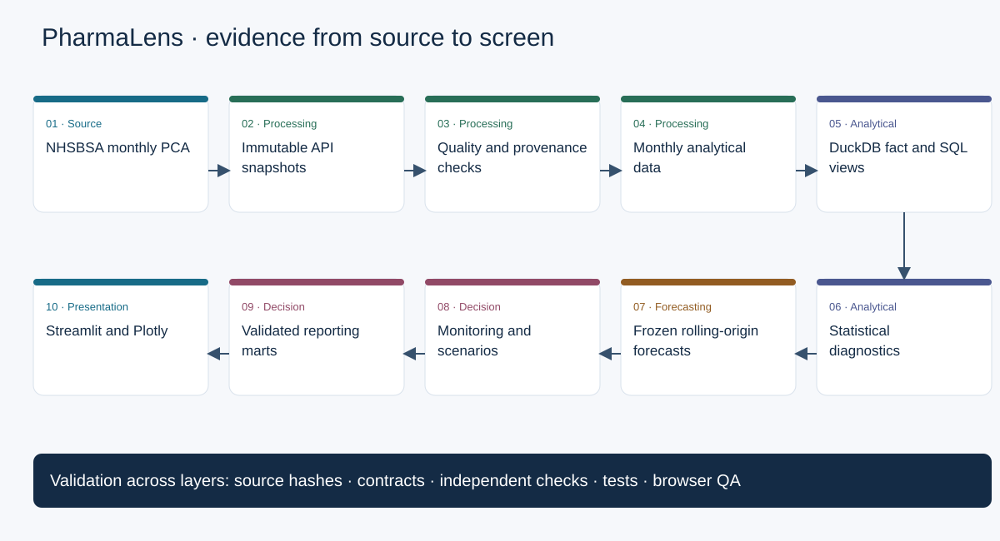
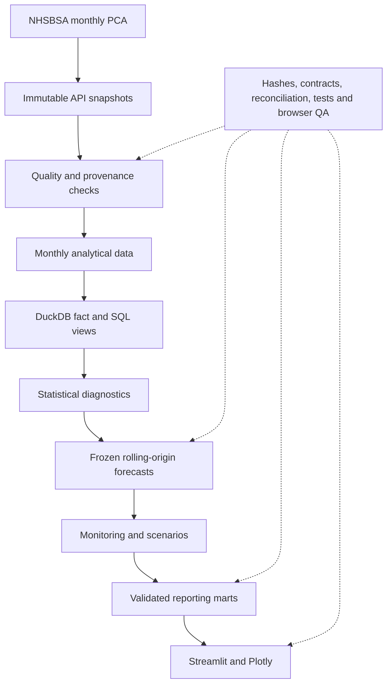

# Project architecture

## Reproducible diagram source

The [Mermaid source](assets/architecture.mmd) and SVG are generated from the same ordered flow in `src/phase7_portfolio.py`; the SVG is a reproducible vector diagram, not a screenshot. Source records retain immutable acquisition receipts. Monthly rows are keyed by month, BNF presentation and region with physical unit retained. SQL uses explicit grains, calendar joins and weighted ratios. Phase 3 describes observations; it does not create causal features. Phase 4 accepts origin-sliced training, freezes development choices and evaluates holdout. Phase 5 exposes illustrative monitoring policies and accounting assumptions. Phase 6 consumes hash-checked Parquet marts read-only.

## KPI lineage

| Display | Input columns / transformation | Period and unit | Screen |
|---|---|---|---|
| Total items | `cost_analytics.prescription_items`, observed sum | Active month window; prescription items | Executive |
| NIC | `cost_analytics.net_ingredient_cost_gbp`, observed sum | Active window; GBP | Executive |
| Weighted NIC/item | sum NIC / sum items, positive denominator | Same scope; GBP/item | Executive, regional, presentation |
| Annual change | current complete year / preceding complete year − 1 | Two complete years; percent | Executive, regional, presentation |
| Region/presentation count | distinct keys in filtered observed fact | Active window; entities | Executive |
| Contributions | filtered group sum / disclosed observed denominator | Year/window; percent | Regional/presentation |
| Forecast accuracy | stored successful paired origins; train-only scale | Development or final holdout; explicit horizon | Forecasting |
| Monitoring | stored normalized components and configured weights | Fixed Phase 5 cohort; score and tier | Decision |
| Scenario NIC | baseline items × (1+v) × baseline NIC/item × (1+c) | Stated historical/retrospective baseline; hypothetical GBP | Scenario |

The complete dataset paths, schemas, keys and hashes are in `config/dashboard_manifest.json`. Machine inventory and lineage evidence remain in `outputs/phase7/validation`. Physical quantities are not aggregated across incompatible units. Missing cells remain unknown. Presentation aggregates with partial regional coverage are explicitly limited.
